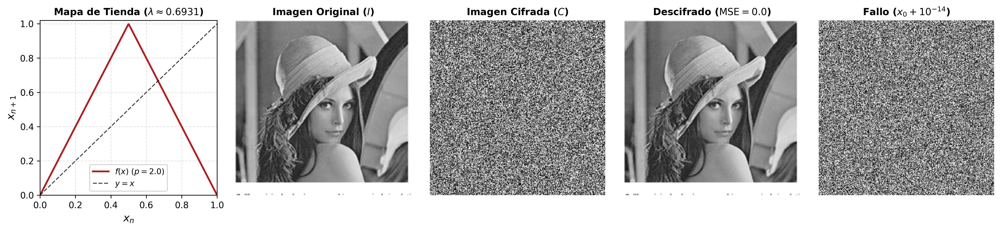
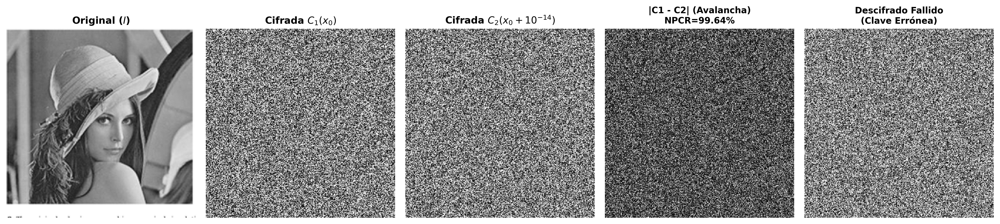

# Diagnóstico Numérico del Caos en el Mapa de Tienda y Cifrado de Imágenes (Amin et al., 2010)

[](https://www.python.org/)
[]()
[](https://numpy.org/)
[](https://python-pillow.org/)
[](LICENSE)

> **Curso:** Computación Científica  
> **Docente:** Juan Fernando Paz  
> **Evaluación:** Primera Entrega — Formulación y Solución del Problema  
> **Institución:** Pontificia Universidad Javeriana Cali  

---

## 1. Visión General del Proyecto

Este repositorio contiene la **Primera Entrega** del curso de Computación Científica, estructurado en torno a dos ejes matemáticos y computacionales:

1. **Modelado y Diagnóstico del Caos en el Mapa de Tienda (*Tent Map*):** Estudio analítico y numérico del **Coeficiente de Lyapunov ($\lambda$)**, deducción de su solución exacta ($\lambda(p) = \ln(p)$), verificación de su régimen caótico monótono continuo en $p=2.0$ ($\lambda = \ln(2) \approx 0.693147$), y justificación de su superioridad frente a modelos alternativos como el logístico debido a la ausencia total de ventanas de periodicidad estables (Li \& Yorke, 1975; Zhang \& Liu, 2023).
2. **Cifrado Caótico de Imágenes Digitales (Amin et al., 2010):** Criptosistema simétrico para imágenes digitales en escala de grises que integra confusión por ordenamiento indirecto de órbitas caóticas y difusión XOR encadenada, con soporte para procesar **cualquier imagen arbitraria** (PNG, JPG, BMP), evaluando cuantitativamente la **Fidelidad de Descifrado** ($\text{MSE} = 0.0$) y la **Sensibilidad a la Clave** mediante las métricas estandarizadas **NPCR** y **UACI** ante perturbaciones microscópicas de la clave secreta ($\Delta x_0 = 10^{-14}$) según el marco teórico de Wu, Noonan y Agaian (2011).

---

## 2. Galería de Resultados Visuales

### 2.1. Barrido Paramétrico del Coeficiente de Lyapunov en el Mapa de Tienda ($\lambda(p) = \ln(p)$)
Concordancia analítica exacta y ausencia total de ventanas periódicas en $p > 1$, garantizando un régimen caótico uniforme continuo para criptografía en $p=2.0$:


### 2.2. Demostración de Cifrado y Descifrado Exacto (Amin et al., 2010)
Proceso completo de cifrado y descifrado sobre imagen real de prueba (256x256): (a) mapa de tienda generador; (b) imagen original; (c) imagen cifrada nominal; (d) descifrado exacto con clave legítima ($\text{MSE} = 0.000000$); (e) descifrado fallido ante clave errónea ($x_0 + 10^{-14}$):



### 2.3. Comparativa Visual de Sensibilidad y Efecto Avalancha
Demostración visual de cómo agregar una perturbación microscópica de apenas $\Delta x_0 = 10^{-14}$ a la clave secreta cambia por completo toda la imagen cifrada resultante:



* **Panel (b) vs. Panel (c):** Dos imágenes cifradas aparentemente idénticas pero generadas con claves separadas por $10^{-14}$.
* **Panel (d):** Matriz de diferencia absoluta $|C_1 - C_2|$, evidenciando ruido blanco homogéneo con $\text{NPCR} = 99.64\%$ y $\text{UACI} = 33.46\%$, lo que comprueba que una variación infinitesimal modifica integralmente el resultado.
* **Panel (e):** Falla catastrófica del descifrado ante una clave errónea (tasa de error del $99.48\%$).

---

## 3. Fundamentación Matemática y Algorítmica

### 3.1. Coeficiente de Lyapunov en Mapas Unidimensionales
Dada una relación de recurrencia discreta $x_{n+1} = f(x_n)$, el Coeficiente de Lyapunov mide la tasa exponencial asintótica de divergencia orbital entre condiciones iniciales infinitesimalmente cercanas:
$$\lambda = \lim_{N \to \infty} \frac{1}{N} \sum_{i=0}^{N-1} \ln |f'(x_i)|$$

* **$\lambda < 0$:** Régimen contractivo/estable (convergencia a punto fijo o ciclo periódico).
* **$\lambda = 0$:** Régimen neutro o frontera de bifurcación.
* **$\lambda > 0$:** **Régimen caótico** (divergencia exponencial de trayectorias e hipersensibilidad inicial).

Para el **Mapa de Tienda**:
$$f(x) = \begin{cases} px, & x < 0.5 \\ p(1-x), & x \ge 0.5 \end{cases} \implies |f'(x)| = p \implies \lambda(p) = \ln(p)$$

En $p=2.0$, $\lambda = \ln(2) \approx 0.69314718 > 0$ con densidad uniforme $U(0, 1)$, ideal para criptografía.

#### Precauciones algorítmicas implementadas (`src/lyapunov.py`):
1. **Descarte de transitorios:** Se omiten $N_{\text{trans}} = 500$ pasos iniciales para converger al atractor dinámico.
2. **Salvaguarda contra singularidades ($\varepsilon = 10^{-14}$):** Acotación $\max(|f'(x)|, 10^{-14})$ para evitar indeterminaciones $\ln(0)$.
3. **Suma logarítmica estable:** Conversión de productos de derivadas a sumatorias para evitar desbordamientos numéricos (*overflow/underflow*).

### 3.2. Criptosistema Caótico 1D (Amin et al., 2010)
Implementado en `src/cipher.py` sobre una imagen en escala de grises de $M \times N$ píxeles ($L = M \cdot N$):
1. **Keystream:** A partir de una semilla secreta $x_0$ y $p=2.0$, se genera la secuencia caótica $X$ y los bytes de clave $S_i = \lfloor |x_i| \cdot 10^{14} \rfloor \pmod{256}$.
2. **Permutación Espacial (Confusión):** Se reordenan los píxeles según $\mathbf{perm} = \operatorname{argsort}(X)$: $P'_i = P[\mathbf{perm}[i]]$.
3. **Difusión XOR Encadenada:**
   $$C_i = P'_i \oplus S_i \oplus C_{i-1}, \quad \text{con } C_{-1} = \text{IV} = 105$$
4. **Descifrado Invertible sin Pérdidas:**
   $$P'_i = C_i \oplus S_i \oplus C_{i-1}, \quad P[\mathbf{perm}[i]] = P'_i \implies \text{MSE} = 0.0$$

---

## 4. Resultados Experimentales y Métricas

### 4.1. Validación Numérica del Coeficiente de Lyapunov (Mapa de Tienda)
| Parámetro | Régimen Dinámico | $\lambda$ Analítico | $\lambda$ Numérico | Error Absoluto | Diagnóstico |
| :---: | :--- | :---: | :---: | :---: | :--- |
| **$p = 2.0$** | Caos Uniforme Pleno | $\ln(2) \approx 0.69314718$ | $0.69314718$ | $1.09 \times 10^{-13}$ | Caos continuo sin ventanas periódicas |
| **$p = 0.8$** | Contracción al Origen | $\ln(0.8) \approx -0.22314355$ | $-0.22314355$ | $2.06 \times 10^{-14}$ | Contracción asintótica estable |

### 4.2. Métricas Criptográficas y Sensibilidad a la Clave (Wu et al., 2011)
Resultados obtenidos sobre imagen estándar de $256 \times 256$ píxeles:

| Métrica de Evaluación | Valor Experimental | Cota Teórica Ideal [Wu et al., 2011] | Interpretación Dinámica y de Seguridad |
| :--- | :---: | :---: | :--- |
| **Fidelidad de Descifrado (MSE)** | $\text{MSE} = 0.000000$ | $0.0$ | Reconstrucción idéntica e invertible sin pérdidas. |
| **NPCR (Sensibilidad a Clave $10^{-14}$)** | $99.6414\%$ | $99.6094\%$ | Dispersión global de cambios: el 99.64% de los píxeles cambia de valor. |
| **UACI (Sensibilidad a Clave $10^{-14}$)** | $33.4572\%$ | $33.4635\%$ | Concordancia estricta con el ruido blanco uniforme ideal. |
| **Tasa de Fallo con Clave Errónea** | $99.4827\%$ | $\approx 100.0\%$ | Falla total de descifrado ante variación infinitesimal de clave. |

---

## 5. Estructura del Repositorio

```text
Proyecto-Computacion-Cientifica/
├── data/
│   └── sample_lena.png                 # Imagen estándar de prueba (256x256)
├── docs/
│   ├── INFORME_PRIMERA_ENTREGA.tex     # Documento formal (8 secciones, <= 8 págs de cuerpo)
│   ├── GUIA_SUSTENTACION.tex           # Banco de preguntas/respuestas de sustentación
│   ├── RESUMEN_PAPERS.tex              # Trazabilidad bibliográfica de las referencias
│   └── TEORIA_EXPONENTE_LYAPUNOV.tex   # Respaldo teórico extendido
├── figures/
│   ├── tent_lyapunov.png               # Barrido de lambda(p) en el Mapa de Tienda
│   ├── encryption_results.png          # Demostración del cifrado 1D (Amin et al.)
│   ├── sensitivity_analysis.png        # Comparativa visual de sensibilidad y avalancha
│   ├── logistic_lyapunov.png           # Barrido auxiliar del Mapa Logístico
│   └── lyapunov_comparison_logistic_vs_tent.png # Comparación de modelos
├── outputs/                            # Carpeta con imágenes exportadas individuales
│   ├── sample_lena_original.png
│   ├── sample_lena_cifrada.png
│   ├── sample_lena_descifrada.png
│   ├── sample_lena_cifrada_perturbada.png
│   ├── sample_lena_diferencia_sensibilidad.png
│   └── sample_lena_descifrada_fallida.png
├── src/
│   ├── __init__.py                     # Exportaciones modulares
│   ├── maps.py                         # Clases TentMap y LogisticMap
│   ├── lyapunov.py                     # Cálculo y barridos del Coeficiente de Lyapunov
│   ├── cipher.py                       # Criptosistema 1D, I/O de imágenes y métricas
│   └── visualizer.py                   # Renderizado y generación de figuras a 300 DPI
├── tests/
│   └── test_lyapunov.py                # 5 pruebas unitarias esenciales con sustento teórico
├── run_experiments.py                  # Script principal con interfaz CLI
├── requirements.txt                    # Dependencias del proyecto
└── README.md
```

---

## 6. Instrucciones de Instalación y Ejecución

### Requisitos Previos:
```bash
pip install -r requirements.txt
```

### Ejecutar Pruebas Unitarias Automatizadas:
```bash
python -m unittest discover tests -v
```

### Ejecutar Benchmarks y Generar Figuras Científicas:
```bash
python run_experiments.py
```

### Cifrar y Descifrar Cualquier Imagen Propia:
El script permite procesar cualquier archivo de imagen digital compatible (`.png`, `.jpg`, `.jpeg`, `.bmp`) y exportar los resultados a una carpeta designada:
```bash
python run_experiments.py --image ruta/a/tu_imagen.png --output-dir mis_resultados
```
El pipeline generará y guardará automáticamente:
1. `tu_imagen_original.png`: Imagen normalizada en escala de grises.
2. `tu_imagen_cifrada.png`: Criptograma nominal cifrado con $x_0$.
3. `tu_imagen_descifrada.png`: Imagen recuperada con clave legítima ($\text{MSE} = 0.0$).
4. `tu_imagen_cifrada_perturbada.png`: Criptograma con clave modificada en $10^{-14}$.
5. `tu_imagen_diferencia_sensibilidad.png`: Matriz de diferencia visual $|C_1 - C_2|$.
6. `tu_imagen_descifrada_fallida.png`: Resultado del intento de descifrado con clave incorrecta.
