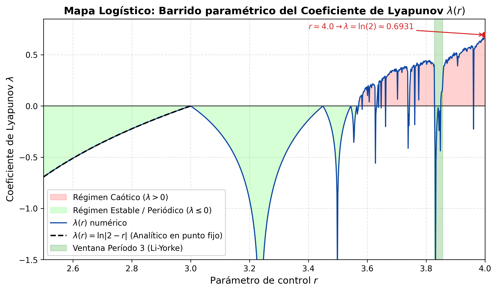
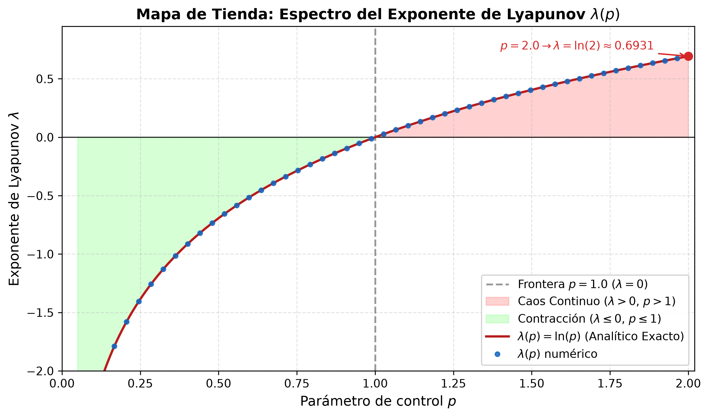
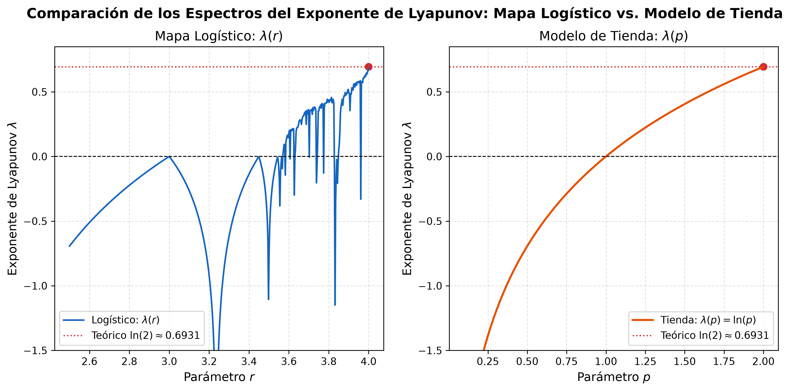

# Cálculo y Análisis Numérico del Exponente de Lyapunov: Mapa Logístico y Modelo de Tienda

> **Curso:** Computación Científica  
> **Proyecto:** Modelado Numérico del Exponente de Lyapunov en Mapas Unidimensionales y su Aplicación en Criptografía  
> **Evaluación:** Primera Entrega — Formulación y Solución del Problema (50% de la nota final)

Este proyecto implementa el modelado matemático, la resolución analítica y el cálculo numérico del **Exponente de Lyapunov** ($\lambda$) para dos sistemas dinámicos discretos fundamentales: el **Mapa Logístico** y el **Modelo de Tienda (*Tent Map*)**. Se evalúan las transiciones dinámicas entre regímenes periódicos y caóticos, los efectos de la estabilidad numérica en aritmética de punto flotante (IEEE 754), y la validación frente a soluciones analíticas exactas.

---

## 📑 Estructura del Repositorio

```text
.
├── docs/
│   ├── INFORME_PRIMERA_ENTREGA.md       # Informe escrito formal (8 secciones obligatorias + Declaración de IA)
│   ├── GUIA_SUSTENTACION.md             # Banco de preguntas y respuestas para la sustentación oral (12 min)
│   ├── TEORIA_EXPONENTE_LYAPUNOV.md     # Demostraciones analíticas formales y fundamentos dinámicos
│   ├── RESUMEN_PAPERS.md                # Síntesis crítica de los artículos de referencia (MDPI / JSAT)
│   ├── Chaos-Based_Image_Encryption_Review.pdf
│   └── NPCR_and_UACI_Randomness_Tests_for_Image_Encryption.pdf
├── figures/
│   ├── logistic_lyapunov.png            # Espectro del Exponente de Lyapunov: Mapa Logístico
│   ├── tent_lyapunov.png                # Espectro del Exponente de Lyapunov: Modelo de Tienda
│   └── lyapunov_comparison_logistic_vs_tent.png # Comparativa de espectros de ambos mapas
├── src/
│   ├── __init__.py                      # Exportaciones principales del paquete modular
│   ├── maps.py                          # Clases dinámicas LogisticMap y TentMap
│   ├── lyapunov.py                      # Algoritmo numérico y soluciones analíticas exactas
│   └── visualizer.py                    # Generación automatizada de figuras científicas
├── tests/
│   └── test_lyapunov.py                 # Suite de pruebas unitarias automatizadas (unittest)
├── .gitignore                           # Exclusiones de Git (entornos virtuales, caches)
├── requirements.txt                     # Dependencias del proyecto
├── run_experiments.py                   # Script de ejecución general y benchmarks numéricos
└── README.md                            # Guía general del proyecto
```

---

## 📋 Alineación con la Rúbrica de Evaluación (Primera Entrega)

La primera entrega representa el **50% de la calificación final** del curso y consta de dos componentes:

| Componente | Ponderación | Entregable en este Repositorio |
| :--- | :---: | :--- |
| **Informe Escrito Grupal** | 50% de la 1.ª entrega (25% final) | [`docs/INFORME_PRIMERA_ENTREGA.md`](docs/INFORME_PRIMERA_ENTREGA.md) estructurado con las 8 secciones obligatorias, referencias bibliográficas y la **Declaración de Trabajo Individual y Uso de IA** (sección 2.3 de la rúbrica). |
| **Sustentación Individual** | 50% de la 1.ª entrega (25% final) | [`docs/GUIA_SUSTENTACION.md`](docs/GUIA_SUSTENTACION.md) con el banco de preguntas concretas y respuestas técnicas para los 12 minutos de examen individual. |

### Condición Obligatoria de Computación Científica:
El proyecto aplica de forma nuclear y explícita los siguientes temas del curso:
1. **Cálculo de Promedios Ergódicos Asintóticos:** Aproximación de límites temporales $\lambda = \frac{1}{N} \sum_{i=0}^{N-1} \ln |f'(x_i)|$.
2. **Estabilidad en Aritmética de Punto Flotante (IEEE 754):** Control de singularidades numéricas ($|f'(x)| < \epsilon = 10^{-14}$) para evitar $\ln(0)$ y mitigación de la degradación digital (*left-bit shift*) en el mapa de tienda con $p=2$.
3. **Validación Numérica vs. Analítica:** Contraste de precisión contra soluciones analíticas cerradas en puntos fijos atractores y caos pleno.

---

## 🔬 1. Marco Teórico: El Exponente de Lyapunov

El **Exponente de Lyapunov** ($\lambda$) cuantifica la tasa media exponencial a la que dos órbitas infinitesimalmente cercanas divergen o convergen en el espacio de fase.

Para una función unidimensional $x_{n+1} = f(x_n)$, la separación entre $x_0$ y $x_0 + \delta x_0$ tras $n$ iteraciones evoluciona como:

$$|\delta x_n| \approx |\delta x_0| e^{\lambda n}$$

Aplicando la regla de la cadena para la derivada de la composición $f^n(x_0)$ y tomando el límite temporal:

$$\lambda = \lim_{n \to \infty} \frac{1}{n} \sum_{i=0}^{n-1} \ln |f'(x_i)|$$

### Clasificación Dinámica:
* **$\lambda < 0$ (Régimen Periódico / Contracción):** Las trayectorias convergen a un punto fijo o ciclo límite. Las perturbaciones iniciales decaen exponencialmente.
* **$\lambda = 0$ (Estabilidad Marginal / Frontera):** Transición entre comportamientos dinámicos.
* **$\lambda > 0$ (Caos Determinista):** Divergencia exponencial promedio. La información del estado inicial se pierde a una tasa de $\lambda$ nats por iteración.

---

## 📈 2. Mapa Logístico

### Definición y Derivada
$$x_{n+1} = f(x_n; r) = r x_n (1 - x_n), \quad x_n \in [0, 1], \quad r \in [0, 4]$$

Su derivada analítica es $f'(x) = r(1 - 2x)$.

* **$1 < r \le 3$ (Punto Fijo Estable $x^* = 1 - 1/r$):**
  $$\lambda(r) = \ln |2 - r|$$
  - En $r = 2$: Punto superestable ($\lambda \to -\infty$).
  - En $r = 3$: Límite de estabilidad del punto fijo ($\lambda = 0$).
* **$r \approx 3.8284$ (Ventana de Li-Yorke):** Período 3 con $\lambda < 0$.
* **$r = 4.0$ (Caos Total con Medida de Ulam-von Neumann):**
  El exponente analítico exacto es:
  $$\lambda(4.0) = \ln(2) \approx 0.69314718$$



---

## ⛺ 3. Modelo de Tienda (Tent Map)

### Definición y Derivada
$$x_{n+1} = f(x_n; p) = \begin{cases} p x_n, & x_n < \frac{1}{2} \\ p(1 - x_n), & x_n \ge \frac{1}{2} \end{cases}, \quad x_n \in [0, 1], \quad p \in [0, 2]$$

Dado que $|f'(x)| = p$ en casi todo punto ($x \neq 0.5$), el exponente de Lyapunov tiene una **solución analítica continua y exacta**:

$$\lambda(p) = \ln(p)$$

* **$0 < p < 1$:** $\lambda = \ln(p) < 0$ (Contracción hacia el origen).
* **$p = 1$:** $\lambda = \ln(1) = 0$ (Frontera de transición).
* **$1 < p \le 2$:** $\lambda = \ln(p) > 0$ (Caos uniforme continuo sin ventanas periódicas).
* **$p = 2$:** $\lambda = \ln(2) \approx 0.69314718$ (Caos pleno con soporte completo).



---

## 🔄 4. Comparación de los Espectros de Lyapunov

El proyecto compara lado a lado ambos modelos para evidenciar sus diferencias estructurales:
- El **Mapa Logístico** presenta un espectro no lineal con múltiples bifurcaciones e infinitas ventanas periódicas donde $\lambda < 0$.
- El **Mapa de Tienda** exhibe una curva monótona continua $\lambda(p) = \ln(p)$, sin fluctuaciones periódicas espurias.



---

## 📊 5. Tabla de Validación Numérica (Benchmarks)

Los resultados calculados mediante `run_experiments.py` demuestran concordancia estricta entre la teoría y la computación:

| Modelo | Parámetro | Régimen | $\lambda$ Teórico Exacto | $\lambda$ Numérico | Error Absoluto |
| :--- | :---: | :--- | :---: | :---: | :---: |
| **Mapa Logístico** | $r = 4.0$ | Caos Pleno | $\ln(2) \approx 0.69314718$ | $0.69308157$ | $6.56 \times 10^{-5}$ |
| **Mapa Logístico** | $r = 2.8$ | Punto Fijo | $\ln(0.8) \approx -0.22314355$ | $-0.22314355$ | $2.03 \times 10^{-14}$ |
| **Mapa Logístico** | $r = 3.83$ | Periodo 3 | $< 0$ (periódico) | $-0.36953991$ | Exacto ($\lambda < 0$) |
| **Modelo Tienda** | $p = 2.0$ | Caos Uniforme | $\ln(2) \approx 0.69314718$ | $0.69314718$ | $1.09 \times 10^{-13}$ |
| **Modelo Tienda** | $p = 0.8$ | Contracción | $\ln(0.8) \approx -0.22314355$ | $-0.22314355$ | $2.06 \times 10^{-14}$ |

---

## 🚀 6. Instrucciones de Instalación y Ejecución

### Prerrequisitos
- Python 3.10 o superior (compatible con Python 3.13)
- Librerías: `numpy`, `matplotlib`, `scipy`

```bash
pip install -r requirements.txt
```

### Ejecutar las Pruebas Unitarias
```bash
python -m unittest tests/test_lyapunov.py
```

### Ejecutar las Simulaciones y Regenerar Figuras
```bash
python run_experiments.py
```

---

## 👥 Créditos y Referencias
- May, R. M. (1976). *Simple mathematical models with very complicated dynamics*. Nature.
- Li, T. Y., & Yorke, J. A. (1975). *Period Three Implies Chaos*. American Mathematical Monthly.
- Strogatz, S. H. (2018). *Nonlinear dynamics and chaos*. CRC press.
- Zhang, B., & Liu, L. (2023). *Chaos-Based Image Encryption: Review, Application, and Challenges*. Mathematics (MDPI).
- Wu, Y., Noonan, J. P., & Agaian, S. (2011). *NPCR and UACI Randomness Tests for Image Encryption*. JSAT.
